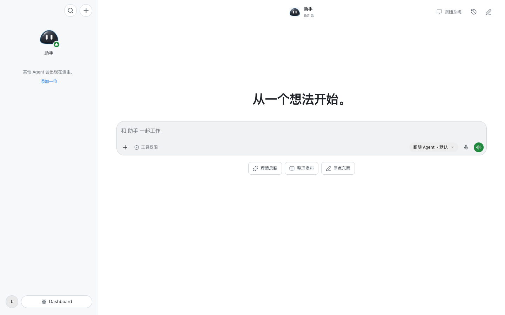

<div align="center">


# Rukksh

**又一个个人 AI 助手**

自托管的 AI 工作台，把对话、个人知识和项目放在一起。

[](https://github.com/ginpika/open-slime/actions/workflows/docker-build.yml)
[](#prebuilt)

[English](./README.md) · **简体中文**

[界面预览](#preview) · [功能](#features) · [快速开始](#quick-start) · [预构建镜像](#prebuilt) · [文档](#documentation)

</div>

<a id="preview"></a>



<a id="features"></a>

## 功能

| 场景 | 能做什么 |
| --- | --- |
| **对话与智能体** | 接入 OpenAI Chat Completions 或 Anthropic Messages 接口，切换模型，为智能体配置各自的提示词、工具和记忆。 |
| **个人知识库** | 导入和整理文档，保存网页快照，通过检索和知识图谱浏览资料。 |
| **项目与编程** | 在不同会话间延续项目上下文，浏览工作空间文件，审阅编程智能体提出的修改。 |
| **多智能体协作** | 分配角色，跟进任务执行过程，在同一个协作空间查看产出。 |

<a id="quick-start"></a>

## 快速开始

安装 **Git、Docker 和 Docker Compose 2.24.0 或更新版本**，在仓库根目录构建并启动前后端。

```sh
git clone https://github.com/ginpika/open-slime.git
cd open-slime
docker compose up -d --build
```

打开 [http://localhost:18081](http://localhost:18081)，进入 **设置 → 大模型**，填写接口格式、服务地址、模型 ID，以及服务所需的 API Key。测试连接后，将该模型设为新会话的默认模型。

Nginx 托管网页，并通过 Compose 网络将 `/api/` 转发给 Spring Boot 后端。SQLite 数据库和应用文件保存在 `rukksh-data` 卷的 `/data` 下。修改根目录 `.env` 中的 `RUKKSH_HOST_PORT` 可调整网页端口。需要修改其他部署参数时，将 [后端环境变量示例](./backend/.env.example) 复制为 `backend/.env`。默认部署无需登录即可访问，设置 `SSO_SERVER_URL` 可启用 HostID 登录。

<a id="prebuilt"></a>

## 预构建镜像

GitHub Actions 在 Linux AMD64 和 ARM64 上构建并验证前后端。Pull Request 运行检查。推送到 `main` 或 `master`、推送 `v*` 标签、手动运行工作流时，会向 GitHub Container Registry 发布 `open-slime-frontend` 和 `open-slime-backend`。两个镜像都带有 `sha-<完整提交 SHA>` 标签。默认分支的当前提交还会更新 `latest`，版本发布会添加 `v1.2.3` 这样的标签。

发布成功后，从发布任务摘要复制 `RUKKSH_IMAGE_TAG`，在对应提交的仓库目录运行以下命令。私有包需要用具备读取权限的账号登录 `ghcr.io`。

```sh
export RUKKSH_IMAGE_TAG='sha-<完整提交 SHA>'
docker compose -f docker-compose.yml -f docker-compose.ghcr.yml pull
docker compose -f docker-compose.yml -f docker-compose.ghcr.yml up -d
```

[GHCR Compose 覆盖文件](./docker-compose.ghcr.yml) 用同一个标签选择前后端镜像，沿用源码部署的端口和数据卷。使用派生仓库发布的包时，将 `RUKKSH_IMAGE_NAMESPACE` 设为 `ghcr.io/<owner>/<repo>`。

## 备份与升级

升级前先停止应用并备份整个 `/data` 数据卷。启动时沿用同一个 Compose 项目和数据卷。源码部署拉取新版后，再执行 `docker compose up -d --build`。镜像部署切换到新版对应的提交，更新 `RUKKSH_IMAGE_TAG`，然后重新执行上面的拉取和启动命令。原 Minis 部署请参阅 [数据迁移说明](./BRANDING.md#5-已有安装升级到-rukksh)。

## 本地开发

前端使用 React、TypeScript 和 Vite，后端使用 Java 21、Spring Boot 和 SQLite，桌面端使用 Tauri。

```sh
# 后端，在仓库根目录执行，需要 JDK 21
cd backend
sh ./mvnw spring-boot:run
```

```sh
# 前端，在另一个终端从仓库根目录执行，需要 Node.js 22.12+
cd frontend
npm ci
npm run dev
```

打开 [http://localhost:5173](http://localhost:5173)。Vite 将 API 请求代理到 `18081` 端口上的后端。

<a id="documentation"></a>

## 文档

| 主题 | 指南 |
| --- | --- |
| 后端结构 | [后端架构](./backend/ARCHITECTURE.md) |
| 记忆与知识库 | [记忆体系](./docs/memory/memory-v6.md) |
| 项目与编程 | [工作空间与项目入口](./docs/ai-coding/AI-Coding工作空间与项目入口-2026-10-14.md) |
| 多智能体协作 | [协作工作空间](./docs/design/collaboration-workspace.md) |
| 桌面端 | [桌面端开发与打包](./desktop/README.md) |
| 品牌与升级 | [品牌配置与旧版数据迁移](./BRANDING.md) |
