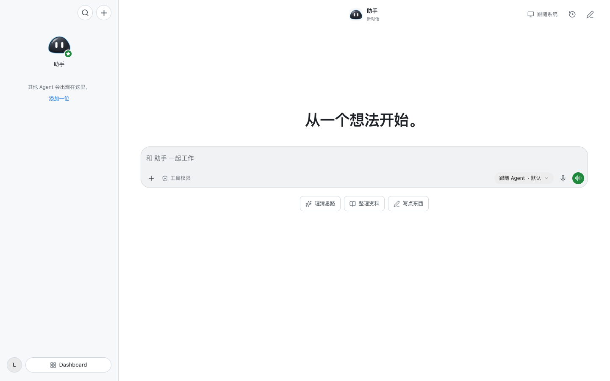

<div align="center">


# Rukksh

**Another Personal AI Assistant**

A self-hosted workspace for AI conversations, personal knowledge, and project work.

[](https://github.com/ginpika/open-slime/actions/workflows/docker-build.yml)
[](#prebuilt)

**English** · [简体中文](./README-zh-CN.md)

[Preview](#preview) · [Features](#features) · [Quick start](#quick-start) · [Prebuilt images](#prebuilt) · [Documentation](#documentation)

</div>

<a id="preview"></a>



## Features

| Use | What you can do |
| --- | --- |
| **Chat and agents** | Configure OpenAI Chat Completions or Anthropic Messages endpoints, switch models, and give agents their own prompts, tools, and memory. |
| **Personal knowledge** | Import and organize documents, save web snapshots, and explore your collection through search and a knowledge graph. |
| **Projects and coding** | Keep project context across sessions, browse workspace files, and review changes proposed by a coding agent. |
| **Multi-agent work** | Assign roles, follow task activity, and review what agents produce in a shared workspace. |

## Quick start

Install **Git, Docker, and Docker Compose 2.24.0 or later**. Build and start both services from the repository root.

```sh
git clone https://github.com/ginpika/open-slime.git
cd open-slime
docker compose up -d --build
```

Open [http://localhost:18081](http://localhost:18081). In **设置 → 大模型** (Settings → Models), add an endpoint with its API format, base URL, model ID, and API key if required. Test the connection and set the model as the default for new conversations.

Nginx serves the web app and proxies `/api/` to the Spring Boot backend over the Compose network. The `rukksh-data` volume stores the SQLite database and application files under `/data`. Set `RUKKSH_HOST_PORT` in the root `.env` to change the web port. For optional deployment settings, copy [the backend environment example](./backend/.env.example) to `backend/.env`. The default deployment allows access without signing in. Set `SSO_SERVER_URL` to enable HostID sign-in.

<a id="prebuilt"></a>

## Prebuilt images

GitHub Actions builds and smoke-tests both services on Linux AMD64 and ARM64. Pull requests run the checks. Pushes to `main` or `master`, `v*` tags, and manual runs publish `open-slime-frontend` and `open-slime-backend` to GitHub Container Registry. Both images receive a `sha-<full commit SHA>` tag. The current default-branch revision also receives `latest`, and version releases receive a tag such as `v1.2.3`.

After the publication job succeeds, copy `RUKKSH_IMAGE_TAG` from its summary. Run these commands from the repository checkout for that revision. If your packages are private, sign in to `ghcr.io` with an account that can read them.

```sh
export RUKKSH_IMAGE_TAG='sha-<full commit SHA>'
docker compose -f docker-compose.yml -f docker-compose.ghcr.yml pull
docker compose -f docker-compose.yml -f docker-compose.ghcr.yml up -d
```

The [GHCR Compose override](./docker-compose.ghcr.yml) selects both prebuilt images with the same tag. It uses the same ports and data volume as a source build. For packages published by a fork, set `RUKKSH_IMAGE_NAMESPACE` to `ghcr.io/<owner>/<repo>`.

## Backups and upgrades

Stop the app and back up the entire `/data` volume before upgrading. Keep the same Compose project and volume when restarting. For a source build, pull the updated code and run `docker compose up -d --build` again. For prebuilt images, check out the new revision, update `RUKKSH_IMAGE_TAG`, and repeat the pull and startup commands above. See the [migration notes](./BRANDING.md#5-已有安装升级到-rukksh) if you are upgrading an installation under the former Minis name.

## Local development

The web app uses React, TypeScript, and Vite. The backend uses Java 21, Spring Boot, and SQLite. The desktop app uses Tauri.

```sh
# Backend, from the repository root with JDK 21
cd backend
sh ./mvnw spring-boot:run
```

```sh
# Frontend, in a separate terminal from the repository root with Node.js 22.12+
cd frontend
npm ci
npm run dev
```

Open [http://localhost:5173](http://localhost:5173). Vite proxies API requests to the backend on port `18081`.

## Documentation

Most guides are in Simplified Chinese.

| Topic | Guide |
| --- | --- |
| Backend structure | [Backend architecture](./backend/ARCHITECTURE.md) |
| Memory and knowledge | [Memory design](./docs/memory/memory-v6.md) |
| Projects and coding | [Workspaces and projects](./docs/ai-coding/AI-Coding工作空间与项目入口-2026-10-14.md) |
| Multi-agent work | [Collaboration workspace](./docs/design/collaboration-workspace.md) |
| Desktop app | [Desktop setup and packaging](./desktop/README.md) |
| Branding and upgrades | [Branding and data migration](./BRANDING.md) |

